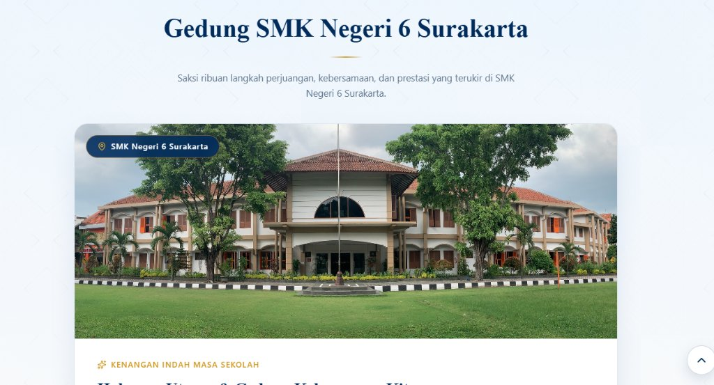
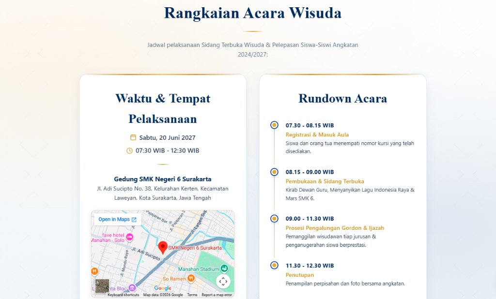
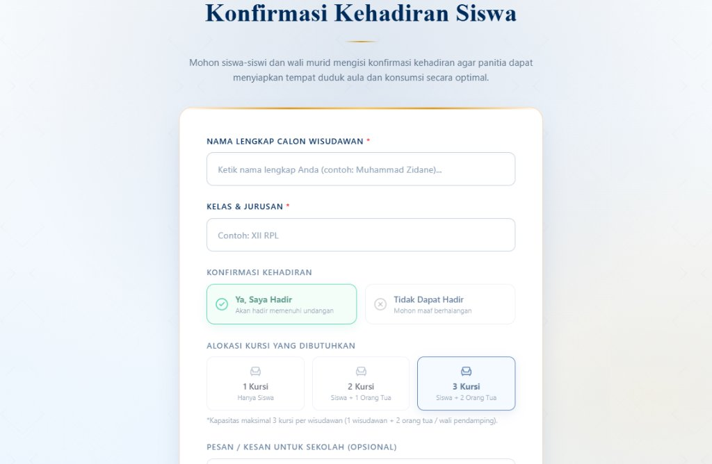
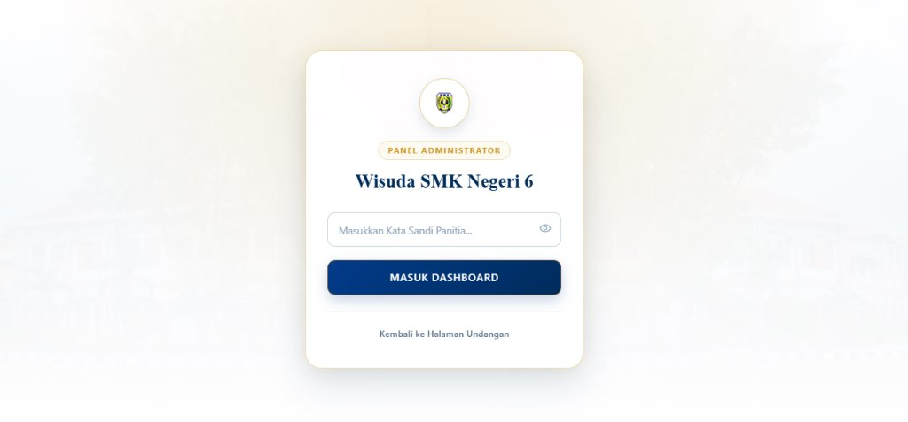
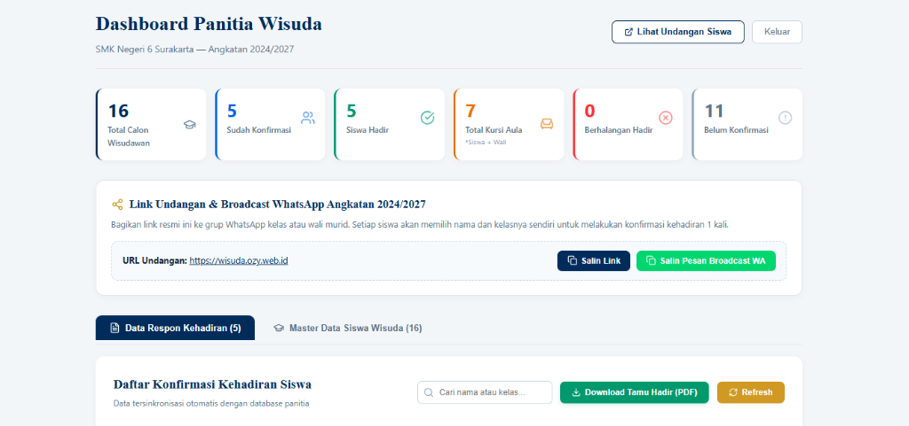
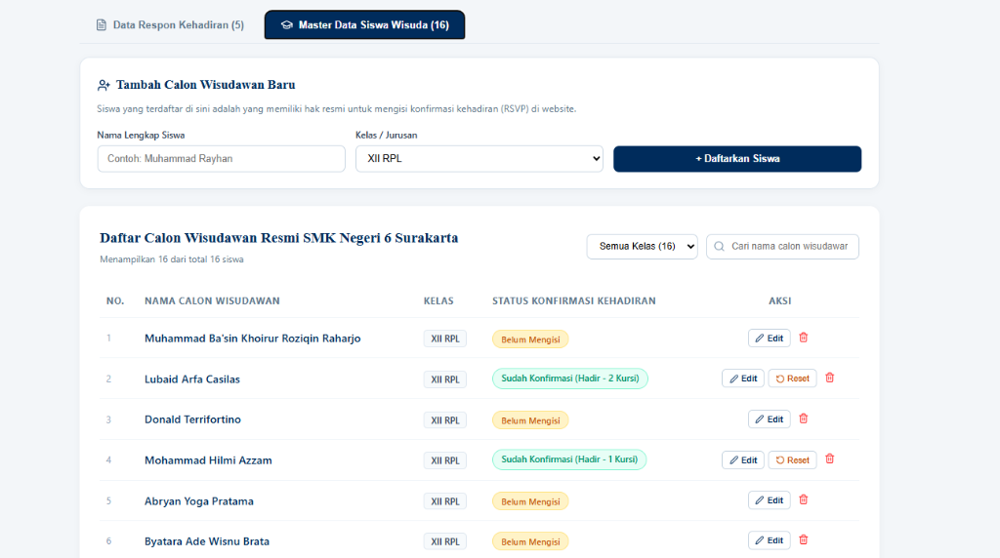

# Undangan Digital Wisuda — SMK Negeri 6 Surakarta
> **Projek Ujian Akhir Keahlian Rekayasa Perangkat Lunak (RPL)**  
> Acara Sidang Terbuka Wisuda & Pelepasan Siswa-Siswi **Angkatan 2024/2027**  
> **SMK Negeri 6 Surakarta**

---

## 1. Latar Belakang & Ringkasan Projek

Projek ini merupakan aplikasi web modern yang dibangun untuk mendigitalkan proses publikasi undangan dan manajemen kehadiran (RSVP) pada acara Sidang Terbuka Wisuda & Pelepasan Siswa SMK Negeri 6 Surakarta Angkatan 2024/2027.

Dengan memanfaatkan teknologi web modern berbasis **Next.js (App Router)** dan **Supabase (PostgreSQL Cloud)**, aplikasi ini menggantikan undangan cetak konvensional menjadi solusi *paperless* yang interaktif, elegan, efisien, serta memudahkan panitia dalam mendata kehadiran wisudawan dan wali murid secara *real-time*.

---

## 2. Tangkapan Layar & Bagian-Bagian Antarmuka Web

Berikut adalah tangkapan layar antarmuka sistem beserta penjelasan ringkas dan akurat pada setiap bagian:

### A. Bagian Halaman Siswa & Tamu Undangan (`/`)

#### 1. Profil Gedung & Identitas Sekolah

* **Penjelasan:** Bagian ini menampilkan foto megah Gedung SMK Negeri 6 Surakarta yang diabadikan sebagai saksi rekam jejak perjuangan para calon wisudawan Angkatan 2024/2027, dilengkapi identitas sekolah dan pengantar sambutan resmi.

#### 2. Rangkaian Acara, Rundown & Google Maps Interaktif

* **Penjelasan:** 
  * **Kartu Waktu & Tempat (Kiri):** Menampilkan jadwal wisuda (Sabtu, 20 Juni 2027, 07:30 - 12:30 WIB) dan peta **Google Maps interaktif tertanam** yang dapat digeser/diperbesar langsung di web, serta tombol tautan navigasi langsung ke aplikasi Google Maps di smartphone tamu.
  * **Kartu Rundown Acara (Kanan):** Linimasa susunan prosesi wisuda mulai dari registrasi kedatangan, upacara sidang terbuka, pengalungan gordon/ijazah, hingga ramah tamah dan foto bersama.

#### 3. Formulir Konfirmasi Kehadiran Siswa (RSVP)

* **Penjelasan:** 
  * Formulir interaktif tempat siswa mengetikkan nama lengkap dan kelas/jurusannya.
  * Dilengkapi validasi kecocokan dengan **16 Calon Wisudawan Resmi SMK 6**.
  * Memungkinkan siswa memilih status kehadiran (*Pasti Hadir / Tidak Dapat Hadir*), menentukan kebutuhan kursi aula (1 hingga 3 kursi), serta menuliskan doa kelulusan.
  * Dilengkapi sistem **Kunci Permanen Otomatis** sehingga siswa yang sudah pernah konfirmasi tidak dapat mengisi ulang demi menjaga kapasitas kursi aula.

---

### B. Bagian Halaman Panel Administrator (`/admin`)

#### 4. Gerbang Masuk & Login Keamanan Admin

* **Penjelasan:** Pintu gerbang proteksi panel panitia. Hanya panitia dengan kata sandi resmi (`wisuda24`) yang dapat mengakses dashboard rekapitulasi data.

#### 5. Dashboard Statistik & Respon Kehadiran Siswa

* **Penjelasan:** 
  * **6 Kartu Ringkasan Real-Time:** Menampilkan angka Total Wisudawan, Jumlah Sudah Konfirmasi, Siswa Hadir, Total Kursi Aula, Berhalangan Hadir, dan Belum Konfirmasi.
  * **Kotak Broadcast WhatsApp:** Tombol cepat untuk *Salin Link Undangan* dan *Salin Pesan Broadcast WA* dengan format kedinasan resmi.
  * **Tabel Konfirmasi RSVP & Download PDF:** Tabel daftar tamu yang masuk dilengkapi tombol hijau **"Download Tamu Hadir (PDF)"** untuk mengunduh rekapitulasi dokumen resmi A4 Landscape secara langsung tanpa dialog print.

#### 6. Manajemen Master Data Calon Wisudawan & Fitur Inline Edit

* **Penjelasan:** 
  * **Tambah Calon Wisudawan:** Formulir pendaftaran siswa baru ke daftar resmi (Nama dan Kelas).
  * **Tabel Master Siswa & Inline Edit:** Menampilkan status kehadiran setiap siswa (*Sudah Konfirmasi / Belum Mengisi*). Dilengkapi tombol **"Edit"** untuk mengubah nama atau kelas siswa secara langsung di tabel tanpa harus menghapus data (otomatis tersinkronisasi ke data RSVP), tombol **"Reset"** jika siswa meminta izin isi ulang, dan tombol **"Hapus"**.

---

## 3. Fitur-Fitur Utama Sistem

1. **Paperless & Interactive**: Menghemat anggaran pencetakan undangan fisik melalui website yang elegan dan responsif di seluruh ukuran layar smartphone maupun PC.
2. **Validasi Master Data Ketat**: Hanya 16 calon wisudawan terdaftar yang memiliki hak mengisi formulir RSVP.
3. **Pencegahan Duplikasi (Anti-Isi Ulang)**: Satu siswa hanya dapat mengirim konfirmasi satu kali. Sesi terkunci permanen di database dan peramban.
4. **Ekspor Rekapitulasi PDF Otomatis**: Panitia dapat mengunduh berkas laporan resmi A4 Landscape berisi daftar lengkap wisudawan yang hadir dan kebutuhan kursi dalam satu klik.
5. **Manajemen Master Data Fleksibel**: Fitur *Inline Edit* memungkinkan panitia memperbaiki nama/kelas siswa secara instan tanpa merusak integritas data relasi.
6. **Ikon Vektor Formal (Bebas Emoji)**: Seluruh tampilan antarmuka menggunakan tipografi elegan dan ikon vektor dari *Lucide React* tanpa unsur emoji informal, mencerminkan identitas instansi pendidikan formal.

---

## 4. Panduan Instalasi (Installation Guide)

Ikuti langkah-langkah berikut untuk mengunduh dan menjalankan projek ini di komputer lokal:

### Prasyarat Sistem
* **Node.js**: Versi `18.17.0` atau yang lebih baru.
* **npm** (bawaan Node.js) atau **pnpm**.
* Peramban web modern (Google Chrome, Mozilla Firefox, Microsoft Edge, dll).
* Koneksi internet aktif (untuk sinkronisasi basis data Supabase Cloud).

### Langkah-Langkah Pemasangan:

1. **Buka terminal atau Command Prompt / PowerShell:**
   Masuk ke folder projek tempat berkas disimpan:
   ```bash
   cd "C:\Users\WINDOWS 11\Projek RPL\UndanganDigital"
   ```

2. **Pasang seluruh dependensi pustaka (*Install Dependencies*):**
   ```bash
   npm install
   ```
   *Perintah ini akan menginstal Next.js, React, Supabase Client, Framer Motion, Lucide React, jsPDF, dan jsPDF-AutoTable.*

3. **Verifikasi Variabel Lingkungan (*Environment Variables*):**
   Pastikan berkas `.env.local` telah berisi konfigurasi Supabase proyek:
   ```env
   NEXT_PUBLIC_SUPABASE_URL=https://[PROJECT-ID].supabase.co
   NEXT_PUBLIC_SUPABASE_ANON_KEY=[YOUR-ANON-KEY]
   NEXT_PUBLIC_ADMIN_PASSWORD=wisuda24
   ```

4. **Jalankan Server Pengembang (*Development Server*):**
   ```bash
   npm run dev
   ```
   Aplikasi akan aktif dan dapat diakses melalui alamat: **`http://localhost:3000`**.

5. **Kompilasi Versi Produksi / Ujian (*Production Build*):**
   Untuk menguji performa maksimal dan memastikan tidak ada error kompilasi:
   ```bash
   npm run build
   npm start
   ```

---

## 5. Panduan Penggunaan Sistem (User & Admin Guide)

### A. Panduan Penggunaan Siswa / Wali Murid
1. **Membuka Undangan**:
   * Akses URL utama: **`http://localhost:3000/`**.
   * Pada halaman pembuka (*Cover Gate*), klik tombol **"Buka Undangan"**.
2. **Melihat Rincian Acara & Peta**:
   * Gulir ke bawah untuk melihat tanggal, jam pelaksanaan, dan rundown prosesi.
   * Lihat denah pada Google Maps interaktif atau klik tombol **"Buka Rute di Aplikasi Google Maps"** untuk navigasi GPS langsung.
3. **Mengisi Konfirmasi Kehadiran (RSVP)**:
   * Pada bagian formulir, ketik nama lengkap Anda (contoh: *Muhammad Zidane*).
   * Ketik atau pilih kelas Anda (contoh: *XII RPL*).
   * Pilih status kehadiran: klik tombol hijau **"Ya, Saya Hadir"** atau tombol abu-abu **"Tidak Dapat Hadir"**.
   * Jika hadir, tentukan alokasi kursi aula (1 Kursi, 2 Kursi, atau 3 Kursi untuk siswa dan pendamping).
   * Tuliskan pesan kesan/doa kelulusan untuk sekolah dan teman-teman.
   * Klik tombol **"Kirim Konfirmasi Kehadiran"**.
4. **Status Terkunci**:
   * Setelah berhasil, layar akan menampilkan kartu bukti konfirmasi resmi yang terkunci permanen. Anda tidak dapat mengisi ulang form demi mencegah duplikasi kursi.

---

### B. Panduan Penggunaan Panitia / Administrator
1. **Masuk ke Panel Administrator**:
   * Buka peramban pada alamat: **`http://localhost:3000/admin`**.
   * Masukkan kata sandi admin: **`wisuda24`** lalu klik **"MASUK DASHBOARD"**.
2. **Memantau Statistik**:
   * Amati 6 kartu metrik di bagian atas dashboard untuk mengetahui kapasitas kursi aula dan jumlah kehadiran secara *real-time*.
3. **Menyebarkan Pesan Broadcast WhatsApp**:
   * Pada kotak broadcast, klik tombol biru **"Salin Link"** untuk membagikan URL saja, atau klik tombol hijau **"Salin Pesan Broadcast WA"** untuk menyalin pesan pengumuman resmi ke grup chat WhatsApp.
4. **Mengunduh Rekapitulasi Tamu (PDF)**:
   * Pada tab **"Data Respon Kehadiran"**, klik tombol hijau **"Download Tamu Hadir (PDF)"**.
   * Dokumen PDF A4 Landscape (`Daftar_Resmi_Tamu_Hadir_SMK6.pdf`) akan otomatis terunduh ke komputer Anda, siap dicetak untuk daftar meja registrasi.
5. **Mengelola Master Data Siswa**:
   * Klik tab **"Master Data Siswa Wisuda"**.
   * **Edit Siswa**: Klik tombol **"Edit"** pada baris siswa untuk mengganti nama atau kelas secara langsung, lalu klik tombol centang hijau **"Simpan"**.
   * **Reset Siswa**: Jika ada siswa yang keliru mengisi dan meminta izin mengisi ulang, klik tombol **"Reset"** pada baris siswa tersebut.
   * **Tambah Siswa**: Masukkan nama dan pilih kelas pada form bagian atas, lalu klik **"+ Daftarkan Siswa"**.

---

## 6. Daftar 16 Calon Wisudawan Resmi Terdaftar

| No. | Nama Calon Wisudawan | Kelas / Jurusan |
| :---: | :--- | :---: |
| 1 | Muhammad Ba'sin Khoirur Roziqin Raharjo | XII RPL |
| 2 | Lubaid Arfa Casilas | XII RPL |
| 3 | Donald Terrifortino | XII RPL |
| 4 | Mohammad Hilmi Azzam | XII RPL |
| 5 | Abryan Yoga Pratama | XII RPL |
| 6 | Byatara Ade Wisnu Brata | XII RPL |
| 7 | Muhammad Zidane | XII RPL |
| 8 | Alvaro Danendra Kurniawanb | XII RPL |
| 9 | Adrian Valentino | XII RPL |
| 10 | Valentino Santoso | XII RPL |
| 11 | Stefano Budi | XII RPL |
| 12 | Aziz Ahmad Juniar | XII RPL |
| 13 | Junior Alfrefo Berned | XII RPL |
| 14 | Damay Mada Setyawan | XII RPL |
| 15 | Desiderius Aditya | XII RPL |
| 16 | Kritiano Agustav | XII RPL |

---

## 7. Teknologi yang Digunakan (Tech Stack)

| Lapisan / Komponen | Teknologi | Keterangan |
| :--- | :--- | :--- |
| **Framework Utama** | [Next.js](https://nextjs.org/) 16.3 (Turbopack) | Server & Client Components dengan App Router modern |
| **Library Antarmuka** | [React](https://react.dev/) 19 | Komponen antarmuka modular, hooks reaktif & state management |
| **Database Cloud** | [Supabase](https://supabase.com/) | Real-time Cloud PostgreSQL Database & REST API |
| **PDF Generator** | [jsPDF](https://github.com/parallax/jsPDF) & [AutoTable](https://github.com/simonbengtsson/jsPDF-AutoTable) | Pembuatan dokumen rekapitulasi kehadiran resmi PDF sisi client |
| **Animasi & Transisi** | [Framer Motion](https://www.framer.com/motion/) | Transisi cover gate, animasi fade-in, dan fluid layout |
| **Ikonografi** | [Lucide React](https://lucide.dev/) | Kumpulan ikon vektor modern, bersih, dan formal (non-emoji) |
| **Desain & Styling** | Modern CSS (`globals.css`) | Glassmorphism, palet Royal Blue & Warm Gold SMK 6 |

---

## 8. Skema Basis Data Supabase (`rsvps`)

```sql
-- Pembuatan tabel konfirmasi kehadiran
CREATE TABLE rsvps (
  id BIGSERIAL PRIMARY KEY,
  name VARCHAR(255) NOT NULL,
  student_class VARCHAR(100) DEFAULT '-',
  attendance VARCHAR(20) NOT NULL, -- 'yes', 'no'
  pax INT DEFAULT 1,
  message TEXT,
  created_at TIMESTAMP WITH TIME ZONE DEFAULT timezone('utc'::text, now()) NOT NULL
);

-- Pengaturan keamanan Row Level Security (RLS)
ALTER TABLE rsvps ENABLE ROW LEVEL SECURITY;

-- Kebijakan membaca data untuk umum (Buku Tamu & Dashboard)
CREATE POLICY "Public Read RSVP" ON rsvps FOR SELECT USING (true);

-- Kebijakan pengiriman formulir konfirmasi
CREATE POLICY "Public Insert RSVP" ON rsvps FOR INSERT WITH CHECK (true);

-- Kebijakan penghapusan data (Admin)
CREATE POLICY "Public Delete RSVP" ON rsvps FOR DELETE USING (true);
```

---

## 9. Struktur Direktori Proyek

```text
UndanganDigital/
├── public/
│   ├── images/
│   │   ├── smk6.png              # Logo resmi SMK Negeri 6 Surakarta
│   │   ├── smk6-depan-web.jpg    # Foto gedung sekolah (dioptimasi web)
│   │   └── ...                   # Aset visual pendukung lainnya
│   ├── screenshots/              # Tangkapan layar dokumentasi antarmuka
│   │   ├── 01-gedung-smk6.jpg
│   │   ├── 02-rangkaian-acara-maps.jpg
│   │   ├── 03-form-rsvp.jpg
│   │   ├── 04-login-admin.jpg
│   │   ├── 05-dashboard-admin.png
│   │   └── 06-master-data-siswa.png
│   ├── favicon.svg               # Favicon browser
│   └── icons.svg                 # Simbol grafis
├── src/
│   ├── app/
│   │   ├── admin/
│   │   │   └── page.jsx          # Panel Admin & Manajemen Master Siswa
│   │   ├── globals.css           # Styling lengkap, tema warna & responsivitas
│   │   ├── layout.jsx            # Layout utama & konfigurasi metadata SEO
│   │   └── page.jsx              # Beranda undangan tamu & form konfirmasi
│   ├── data/
│   │   └── studentsData.js       # Master data 16 calon wisudawan resmi
│   └── supabaseClient.js         # Konfigurasi koneksi klien Supabase
├── LAPORAN_PROJEK_DOCS.md        # Ringkasan proyek siap salin ke Google Docs
├── package.json                  # Dependensi pustaka dan skrip proyek
└── README.md                     # Dokumentasi teknis proyek lengkap
```

---

## 10. Aspek Penilaian Kualitas Perangkat Lunak (Nilai Unggulan RPL)

Projek ini menerapkan standar kompetensi Rekayasa Perangkat Lunak:
- **Clean Architecture & Component-Based Design**: Kode modular, terstruktur, dan mudah dipelihara (*maintainable*).
- **Responsive Web Design**: Tipografi dan tata letak menggunakan fungsi `clamp()` sehingga adaptif di seluruh resolusi (*Mobile HP 360px hingga Desktop 1920px+*).
- **Data Integrity & Validation**: Validasi ketat nama terdaftar serta pencegahan duplikasi data (*1 Siswa = 1 Respon*).
- **Offline & Graceful Fallback**: Menggunakan *local storage cache* sehingga jika jaringan internet terganggu saat demo ujian, aplikasi tetap berjalan lancar tanpa galat (*error-free*).
- **Performance Optimization**: Kompilasi berbasis *Turbopack* dengan *Suspense Boundary* untuk kecepatan pemuatan halaman maksimal.

---

## 11. Identitas Pengembang

- **Projek**: Ujian Praktik / Penugasan Keahlian Rekayasa Perangkat Lunak (RPL)
- **Sekolah**: **SMK Negeri 6 Surakarta**
- **Tahun Ajaran**: 2024/2027
- **Lisensi**: Edukasi & Penggunaan Internal SMK Negeri 6 Surakarta
